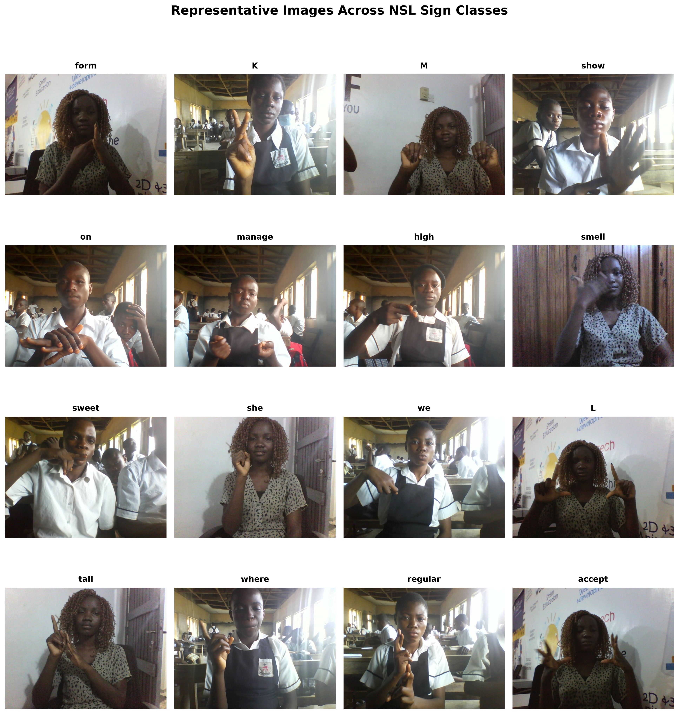
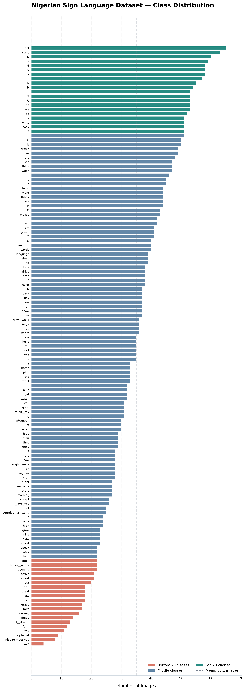
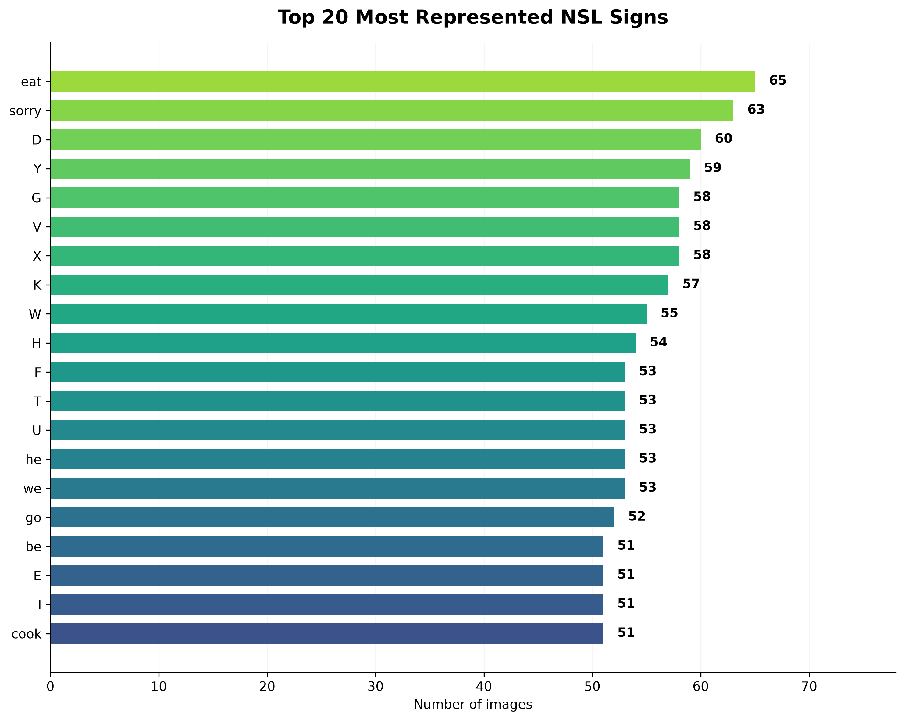
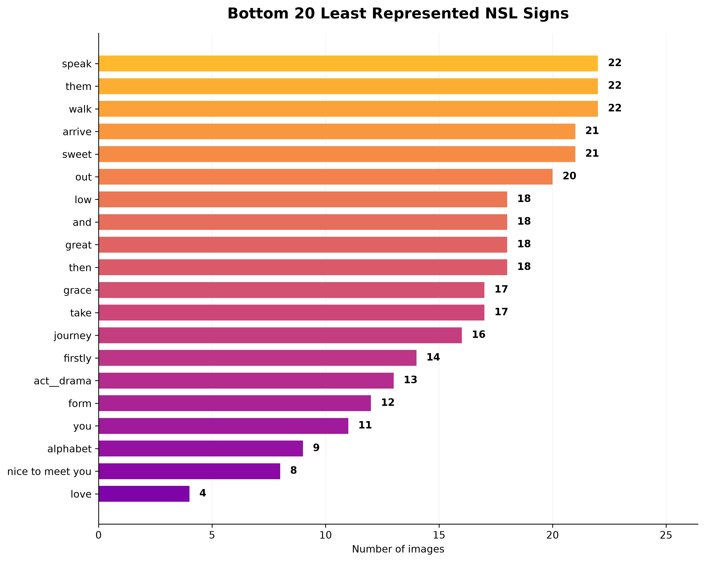
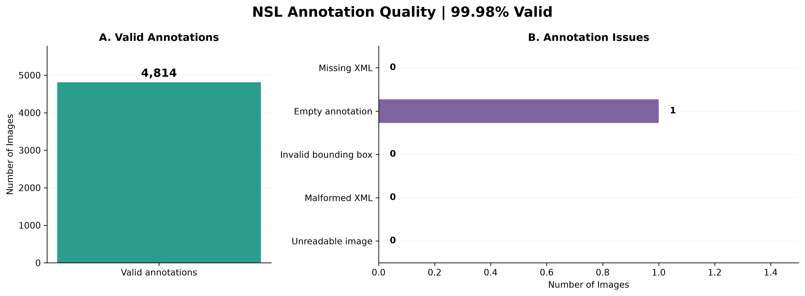
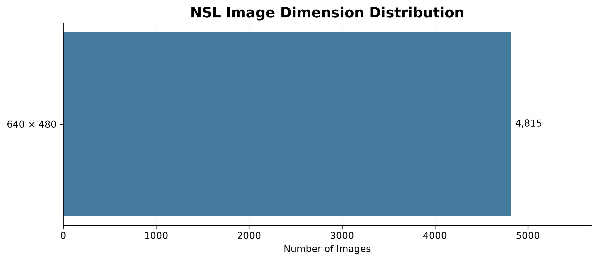
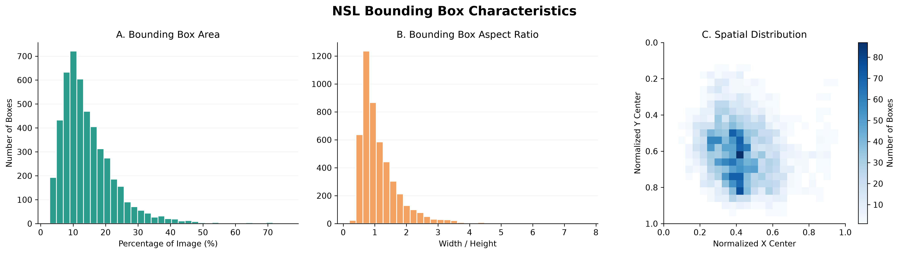
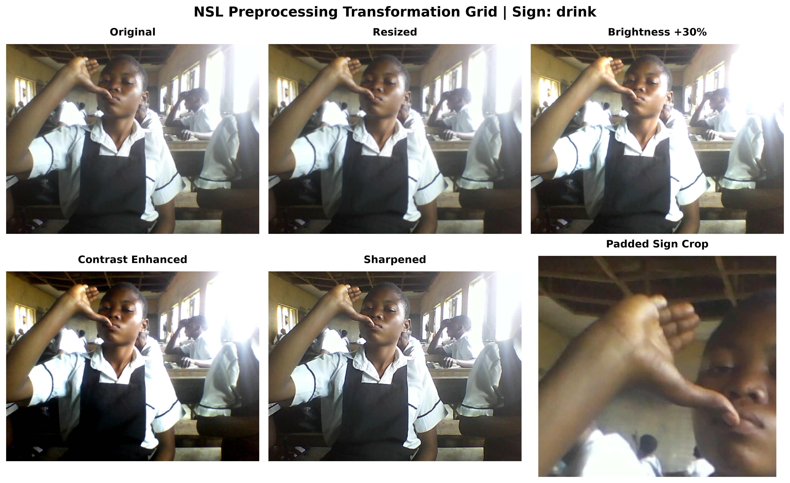

# Nigerian Sign Language Sign-to-Speech Using YOLO26

## Project Overview

This project investigates the use of YOLO26 for recognizing Nigerian Sign Language (NSL) signs and converting recognized signs into speech. The system aims to reduce communication barriers between individuals who use Nigerian Sign Language and people who may not understand it. The project builds upon the work of Kolawole et al. (2021), *Sign-to-Speech Model for Sign Language Understanding: A Case Study of Nigerian Sign Language*, which introduced an NSL image dataset and evaluated YOLOv5, SSD, and MobileNetV2 approaches.

The proposed system uses YOLO26 for sign detection and classification, followed by a confidence-based prediction mechanism and text-to-speech synthesis. A central focus of this project is investigating how different image preprocessing strategies affect sign recognition performance.

Three input representations will be compared:
1. Original images with backgrounds preserved.
2. Images with the target signer isolated and the background removed.
3. Images cropped around annotated signing regions.

The objective is to establish whether background information, background removal, or sign-region cropping provides the most effective image representation for NSL recognition.

---

## Table of Contents

1. [Dataset Overview and Audit](#1-dataset-overview-and-audit)
2. [Raw-Data Visual Diagnostics](#2-raw-data-visual-diagnostics)
3. [Phase 2: EDA Findings and Strategy vs. Reality Audit](#3-phase-2-eda-findings-and-strategy-vs-reality-audit)
4. [Data Cleaning and Preprocessing Pipeline](#4-data-cleaning-and-preprocessing-pipeline)
5. [Comparative Preprocessing Experiments](#5-comparative-preprocessing-experiments)
6. [Original Baseline and Proposed System](#6-original-baseline-and-proposed-system)
7. [Training and Evaluation Strategy](#7-training-and-evaluation-strategy)
8. [Sign-to-Speech Reliability](#8-sign-to-speech-reliability)
9. [Reproducibility and Remaining Work](#9-reproducibility-and-remaining-work)
10. [References](#10-references)

---

# 1. Dataset Overview and Audit

## 1.1 Dataset Description

The dataset used in this project is the [Nigerian Sign Language Sign-to-Speech Dataset](https://huggingface.co/datasets/Lanfrica/sign-to-speech-for-sign-language-understanding-a-case-study-of-nigerian-sign-language), associated with Kolawole et al. (2021).

The original study reports approximately 5,000 cleaned images representing 137 Nigerian Sign Language classes, including alphabet signs, words, and phrases. The images capture individuals performing signs in different environments, with variations in lighting, backgrounds, signer appearance, and camera framing. The dataset contains images and corresponding object-detection annotations in PASCAL VOC and YOLO formats.

The primary task is **multi-class object detection**, where the model predicts:
- The sign class being performed.
- A bounding box localizing the signing region.
- A confidence score for the prediction.

Unlike conventional tabular prediction tasks, the primary input consists of RGB image pixels. Numerical image and annotation features are extracted for exploratory analysis, but the YOLO26 detector learns representations directly from images.

## 1.2 Dataset Statistics

The initial dataset indexing and annotation audit produced the following results:

| Metric | Observed Value |
|---|---|
| Total images | 4,815 |
| Total XML annotation files | 4,815 |
| Number of sign classes | 137 |
| Images with valid extracted bounding boxes | 4,814 |
| Images without a valid extracted box | 1 |
| Bounding-box extraction coverage | 99.98% |
| Raw image dimensions | 640 × 480 pixels |
| Planned YOLO26 input | 640 × 640 pixels |
| Minimum images per class | 4 |
| Maximum images per class | 65 |
| Class imbalance ratio | 16.25:1 |

These counts describe the inspected `dataset/images` and PASCAL VOC annotation collection.

Although all 4,815 images have corresponding XML files, one image did not produce a valid bounding box during the initial extraction process. The reason for this discrepancy must be verified before excluding or repairing the image.

## 1.3 Dataset Structure

The inspected source collection is organized as follows:

```text
dataset/
├── images/
│   ├── A/
│   ├── accept/
│   ├── ...
│   └── other sign classes/
│
└── annotations/
    ├── PASCAL_VOC/
    │   ├── A_....xml
    │   ├── accept_....xml
    │   └── ...
    │
    └── YOLO/
        ├── A_....txt
        ├── accept_....txt
        └── ...
```

The images are organized into folders corresponding to their sign classes, while the annotation files provide class labels and bounding-box coordinates. The source archive may also include other train/test or YOLO directory layouts. These are not assumed to be equivalent to the inspected collection until their contents and class mappings are reconciled.

## 1.4 Example Image and Annotation

### Sample Image

The following image shows an individual performing the sign labeled **"accept"** in a classroom environment.


### Corresponding PASCAL VOC Annotation

The image is accompanied by an XML annotation containing the ground-truth sign class and bounding-box coordinates.

```xml
<annotation>
    <filename>accept_0f05c0f8-16e2-11ec-a3b7-d8fc93b4157c.jpg</filename>

    <size>
        <width>640</width>
        <height>480</height>
        <depth>3</depth>
    </size>

    <segmented>0</segmented>

    <object>
        <name>accept</name>

        <bndbox>
            <xmin>14</xmin>
            <ymin>274</ymin>
            <xmax>502</xmax>
            <ymax>451</ymax>
        </bndbox>
    </object>
</annotation>
```

The annotation identifies:

| Field | Description |
|---|---|
| `filename` | Corresponding image filename |
| `width`, `height`, `depth` | Image dimensions and number of channels |
| `name` | Ground-truth sign class |
| `xmin`, `ymin` | Top-left bounding-box coordinates |
| `xmax`, `ymax` | Bottom-right bounding-box coordinates |
| `segmented` | Whether segmentation information is indicated |

In this example, the signing region is annotated from `(14, 274)` to `(502, 451)`.

**Observation:** The image includes additional people and classroom objects, but the annotation identifies only the target signing region.

The dataset does not provide full-person segmentation masks. Therefore, isolating the target signer requires additional preprocessing beyond the existing XML annotations.

---

# 2. Raw-Data Visual Diagnostics

Exploratory data analysis was conducted to examine the dataset's composition, image characteristics, annotation quality, visual variation, and potential modeling challenges. The figures in this section describe the raw dataset before model training. They do not represent YOLO26 performance results.

## 2.1 Representative Class Image Grid

This visualization displays images from different NSL classes. It provides an overview of variation in sign appearance, signer characteristics, background environments, lighting, and camera framing.



**Purpose:** Understand visual diversity across different sign classes.

## 2.2 Class Distribution

The class-distribution plot shows the number of images available for each of the 137 sign classes.



The distribution reveals that some classes contain substantially more examples than others.

### Top 20 Most Represented Signs



This figure highlights the sign classes with the highest image counts.

### Bottom 20 Least Represented Signs



This figure identifies sign classes with comparatively few training examples.

**Purpose:** Identify class imbalance and determine whether minority classes require additional attention during data splitting and training.

## 2.3 Annotation Coverage and Quality

This visualization examines the availability and structural validity of the dataset's bounding-box annotations.



The initial audit identified 4,814 images with valid extracted bounding boxes out of 4,815 images.
The remaining image requires further annotation inspection.

**Purpose:** Identify missing, empty, malformed, or geometrically invalid annotations before model training.

## 2.4 Image Dimensions

This visualization examines the resolutions of the original images.



The inspected images have a resolution of 640 × 480 pixels, corresponding to an aspect ratio of 4:3.

**Purpose:** Determine whether image dimensions are consistent and identify the transformations required for the YOLO26 input format.

## 2.5 Bounding-Box Analysis

This visualization examines bounding-box area, aspect ratio, and spatial distribution.



The initial analysis reported a median bounding-box area of approximately 12.6% of the image. The visualization helps characterize variation in the size, shape, and position of annotated signing regions.

**Purpose:** Understand spatial characteristics of signs and identify potentially unusual annotations requiring inspection.

## 2.6 Preprocessing Transformation Grid

The transformation grid compares an original image against several illustrative preprocessing operations.



Example transformations include resizing, brightness adjustment, contrast enhancement, sharpening, and cropping.

**Purpose:** Examine how preprocessing changes image appearance and whether important signing information is preserved.

These demonstrations are not evidence that a transformation improves recognition performance.

---

# 3. EDA Findings and Strategy vs. Reality Audit

## 3.1 Overview

Phase 2 evaluates the preprocessing strategy proposed in Phase 1 against the characteristics observed in the actual NSL dataset. The objective is to identify data-quality issues, determine their potential impact on YOLO26 training, and justify any changes to the original preprocessing plan.

The main findings concern:
- Class imbalance.
- Annotation completeness.
- Image dimensions.
- Bounding-box characteristics.
- Background complexity and signer variation.

These findings motivate the data-cleaning pipeline and comparative preprocessing experiments described in subsequent sections.

## 3.2 Finding 1: Class Imbalance

The dataset contains 137 sign classes, but the number of images per class is uneven. Some of the most represented signs include:

| Sign | Images |
|---|---:|
| eat | 65 |
| sorry | 63 |
| D | 60 |
| Y | 59 |
| G | 58 |

Some of the least represented signs include:

| Sign | Images |
|---|---:|
| love | 4 |
| nice to meet you | 8 |
| alphabet | 9 |
| you | 11 |
| form | 12 |

The class imbalance ratio is:

Imbalance Ratio = Largest Class / Smallest Class

**Imbalance Ratio = 65 / 4 = 16.25:1**


### Implications

Classes with more images provide greater opportunities for YOLO26 to learn variations in signing appearance, positioning, and environmental conditions. Classes with very few images may be more difficult to generalize to unseen examples. For instance, the class `love` contains only four original images. This limits both the amount of independent training information available and the reliability of class-specific evaluation. However, class imbalance alone does not prove that the model will perform poorly on minority classes. Its actual impact must be assessed through model evaluation.

### Proposed Decision

- Preserve all valid minority-class images.
- Investigate class-aware sampling strategies compatible with YOLO26.
- Apply conservative, meaning-preserving training augmentation.
- Avoid creating augmented copies before dataset partitioning.
- Investigate additional data collection for extremely rare classes.
- Report per-class performance rather than relying only on aggregate detection metrics.

Augmentation will not be treated as a replacement for independent training examples.

**Status:** Class imbalance identified; mitigation strategies remain to be implemented and evaluated.

## 3.3 Finding 2: Annotation Completeness

The audit identified 4,815 images and 4,815 matching XML annotation files. However, valid bounding boxes were extracted for 4,814 images.

### Implications

YOLO26 requires correctly associated class labels and bounding boxes for supervised object-detection training. An annotation file may exist without containing a usable bounding box, or a parser may fail to extract its contents. Invalid annotations could introduce incorrect supervision or training failures.

### Proposed Decision

- Inspect the affected image and XML annotation.
- Determine whether the issue is an empty annotation, malformed coordinates, or an extraction error.
- Repair the annotation only if correct values can be established.
- Otherwise, exclude the affected image from supervised training and document the decision.
- Preserve the original annotations for reproducibility.

**Status:** Initial audit completed; cause of the extraction discrepancy requires confirmation.

## 3.4 Finding 3: Image Dimensions

The raw dataset uses images measuring 640 × 480 pixels.

The planned YOLO26 input size is 640 × 640 pixels.

### Implications

Directly stretching an image to a square shape could distort hand shapes and body proportions. These visual characteristics may be important for distinguishing signs.

### Proposed Decision

Use aspect-ratio-preserving letterboxing to prepare images for YOLO26. Bounding boxes must be transformed consistently with any geometric image transformation.

**Status:** Image dimensions verified; letterboxing selected for the planned training pipeline.

## 3.5 Finding 4: Bounding-Box Characteristics

The bounding-box analysis reveals variation in the spatial extent and position of annotated sign regions.Some signs may require broader body context, while others may involve smaller regions around the hands.

### Implications

Very small signing regions may contain limited visual detail, while larger boxes may include additional environmental information. Unusual box dimensions do not necessarily imply annotation errors.

### Proposed Decision
- Preserve valid ground-truth bounding boxes.
- Flag unusual box dimensions for inspection.
- Avoid automatically removing large or small annotations.
- Validate coordinates after image resizing or cropping.
- Retain meaningful visual context when performing signer-focused preprocessing.

**Status:** Bounding-box characteristics analyzed; annotation outlier review remains pending.

## 3.6 Finding 5: Background Complexity and Signer Variation

Representative images reveal variation in background environments, lighting, signer appearance, and camera framing. Some images contain additional people, classroom furniture, windows, and other background objects.

### Implications

Irrelevant background information may distract the detector or introduce correlations unrelated to the sign being performed.However, background diversity may also improve robustness to real-world environments. Removing background elements without careful segmentation could accidentally remove relevant hand, face, or upper-body information.

### Proposed Decision

Rather than selecting one preprocessing strategy in advance, the project will compare three image representations:
1. Original images with backgrounds preserved.
2. Background-removed images retaining the target signer.
3. Cropped images focusing on annotated signing regions.

These experiments will investigate whether spatial focus and background modification improve detection performance.

**Status:** Background variation observed; three preprocessing experiments proposed.

---

## 3.7 Strategy vs. Reality Decision Log

The Decision Log documents how Phase 1 preprocessing intentions compare with actual Phase 2 findings and the resulting implementation decisions.

| Area | Phase 1 Strategy | Phase 2 Evidence | Decision or Adjustment | Status |
|---|---|---|---|---|
| Dataset size | Audit the original dataset | 4,815 images, 137 classes | Use observed counts rather than approximate paper totals | Completed |
| Class imbalance | Preserve minority classes; consider augmentation | Class sizes range from 4 to 65 images | Investigate class-aware training and training-only augmentation | Planned |
| Annotation integrity | Exclude unresolved invalid annotations | 4,815 XML files; 4,814 valid extracted boxes | Investigate affected annotation before repair or exclusion | Pending |
| Image dimensions | Preserve image proportions | Raw resolution is 640 × 480 | Use 640 × 640 aspect-ratio-preserving letterboxing | Planned |
| Bounding-box outliers | Flag unusual geometries | Bounding-box analysis completed | Inspect outliers and retain valid extreme cases | Pending |
| Background variation | Initially preserve original images | Images contain variable backgrounds and additional people | Compare original, background-removed, and cropped inputs | Planned |
| Dataset splitting | Use 70/15/15 with leakage prevention | Some classes contain only four images | Reassess rare-class coverage and group constraints | Pending |
| Augmentation | Apply conservative training-only transformations | Class imbalance and visual variation observed | Evaluate safe transformations while avoiding unchecked flipping | Planned |

The main adjustment from Phase 1 is the explicit introduction of three comparative preprocessing configurations. Instead of treating background removal as an assumed improvement, it will be evaluated experimentally. The final Phase 2 report will update this log with actual implementation changes, affected sample counts, and resulting evaluation evidence.

---

# 4. Data Cleaning and Preprocessing Pipeline

## 4.1 Annotation Validation

Before training, image–annotation pairs will be validated to identify:

- Missing or unreadable image files.
- Missing or malformed XML annotations.
- Empty annotations.
- Missing or invalid bounding-box coordinates.
- Coordinates outside image boundaries.
- Inconsistent class labels.
- Differences between corresponding XML and YOLO annotations.

Invalid records will be inspected before any exclusion. Corrections and exclusions will be documented in a reproducible log.

## 4.2 Image Quality and Outlier Handling

Image-quality checks will examine brightness, sharpness, and unusual image characteristics. Bounding-box outliers will be investigated using area, width, height, and aspect ratio.
The IQR method may be used to flag unusual numerical values.However, outliers will not be removed automatically because unusual examples may represent valid signing conditions. Images will be retained when the sign remains interpretable and the annotation is valid.

## 4.3 Class Imbalance Mitigation

To address uneven class representation, the following strategies will be investigated:

- Preserve valid minority-class images.
- Use conservative training-only augmentation.
- Evaluate class-aware sampling where supported by the training framework.
- Maintain the original class distribution in validation and testing where feasible.
- Report performance separately for individual sign classes.
- Prefer additional independent data collection for classes with extremely few examples.

The balancing strategy will be kept consistent across the three preprocessing experiments. This is necessary to isolate the effect of image preprocessing from changes in sample representation.

## 4.4 Image Resizing and Normalization

Images will be prepared using aspect-ratio-preserving letterboxing to the target input size of 640 × 640. The YOLO26 preprocessing pipeline will convert pixel values to the numerical representation expected by the model. Geometric transformations will be accompanied by corresponding annotation-coordinate adjustments. The dataset will not use conventional tabular mean imputation or `StandardScaler` on raw image pixels.

## 4.5 Data Augmentation

Training augmentation may include:

- Modest brightness adjustment.
- Contrast and HSV variation.
- Small translations.
- Controlled scaling.
- Other transformations verified to preserve sign meaning.

Horizontal flipping will remain disabled unless its semantic validity can be established. Validation and test images will not receive stochastic training augmentation.

## 4.6 Duplicate Detection and Data Leakage

Exact duplicates will be investigated using file hashing, while perceptual similarity can be used to identify candidate near-duplicates. Potential duplicate groups will be reviewed before splitting. Near-identical images must not appear across training, validation, and test partitions. Where signer or recording-session information is available, it will also be considered during dataset splitting.

---

# 5. Comparative Preprocessing Experiments

## 5.1 Research Objective

The project will investigate the following research question:

**How does image preprocessing—specifically background preservation, background removal, and sign-region cropping—affect YOLO26 detection performance on Nigerian Sign Language signs?**

Three experiments are proposed to compare different input representations while maintaining consistent training and evaluation conditions.

## 5.2 Experiment A: Original Images (Baseline)

The first experiment will train YOLO26 using the original NSL images.

The backgrounds, surrounding objects, and original visual context will be preserved.

### Procedure

- Use the validated original images.
- Retain ground-truth sign bounding boxes.
- Apply standard aspect-ratio-preserving input preprocessing.
- Train YOLO26 with the selected baseline configuration.
- Evaluate using a fixed validation and test protocol.

### Purpose

Establish baseline recognition and localization performance on the original dataset. This experiment provides the reference against which background removal and cropping will be compared.

## 5.3 Experiment B: Background-Removed Images

The second experiment will train YOLO26 using images in which the target signer is isolated from the background.

### Procedure

- Identify the target signer.
- Remove or mask irrelevant background regions.
- Preserve the face, hands, arms, and relevant upper-body posture.
- Retain valid sign bounding boxes when the image coordinate system is unchanged.
- Review segmentation outputs for missing fingers, arms, or other important signing features.
- Train and evaluate YOLO26 using the corresponding processed images.

### Purpose

Determine whether reducing irrelevant background information improves detection performance. This experiment will also investigate whether background removal causes the loss of information needed to distinguish signs. The segmentation procedure must be reproducible and applicable to unseen images.

## 5.4 Experiment C: Bounding-Box Cropped Images

The third experiment will investigate the use of image crops centered on annotated signing regions.

### Procedure

- Extract the annotated sign region from each image.
- Add padding around the bounding box to retain relevant surrounding context.
- Transform bounding-box coordinates into the crop coordinate system.
- Resize the resulting crops for model input.
- Train YOLO26 using the processed images and adjusted labels.
- Evaluate the resulting predictions.

### Purpose

Examine whether focusing the input on the signing region improves recognition by removing irrelevant visual information.

### Important Evaluation Consideration

The source dataset provides ground-truth bounding boxes, but these are not available at inference time in a real-world application. Therefore, cropping validation or test images using their ground-truth boxes constitutes an **oracle-crop experiment**. Such results cannot be treated as directly equivalent to end-to-end detection results from the original-image and background-removal configurations. For a deployable comparison, a separate automatic localization procedure would need to generate the crop at inference time. Results from oracle cropping will therefore be reported separately unless an equivalent automatic crop-generation pipeline is implemented.

## 5.5 Experimental Comparison

| Experiment | Input Representation | Background | Spatial Focus |
|---|---|---|---|
| A | Original images | Preserved | Original full image |
| B | Background-removed images | Removed or masked | Target signer |
| C | Bounding-box cropped images | Mostly excluded | Annotated sign region with padding |

Where comparisons are methodologically valid, the experiments will use:

- The same class mapping.
- The same original train/validation/test membership.
- The same YOLO26 model variant.
- The same training budget and random seeds.
- Consistent class-balancing policies.
- Equivalent evaluation metrics.

## 5.6 Performance Evaluation

The following metrics will be considered:

| Metric | Purpose |
|---|---|
| Precision | Measure the proportion of predicted detections that are correct |
| Recall | Measure the proportion of ground-truth signs successfully detected |
| mAP@0.5 | Evaluate detection performance at IoU 0.5 |
| mAP@0.5:0.95 | Evaluate localization and classification across IoU thresholds |
| Per-class AP | Identify differences in detection performance across sign classes |
| Inference latency | Assess practical real-time performance |

Special attention will be given to underrepresented classes, visually similar signs, and images containing complex backgrounds. The experiments will not be considered evidence of preprocessing improvements until training and evaluation are completed.

**Status:** Three experimental configurations proposed; implementation and comparative evaluation pending.

---

# 6. Original Baseline and Proposed System

## 6.1 Original Reference Implementation

The original reference implementation used YOLOv5m for sign detection. The model was trained using the NSL dataset and deployed through a DeepStack-based inference pipeline. The live application converted detected sign labels into speech using `pyttsx3`.

### Baseline Characteristics

| Component | Original Implementation |
|---|---|
| Detector | YOLOv5m |
| Input size | 640 × 640 |
| Training epochs | 150 |
| Batch size | 16 |
| Sign classes | 137 |
| Speech synthesis | pyttsx3 |
| Deployment | DeepStack-based pipeline |

The original work reported strong detection performance, including approximately 0.9533 mAP@0.5 and 0.6439 mAP@0.5:0.95. These values are historical reference results rather than directly comparable measurements from the current project. A valid comparison requires careful consideration of dataset partitions, preprocessing, training configuration, and evaluation procedures.

## 6.2 Proposed YOLO26 System

The proposed system will replace YOLOv5m with a YOLO26 detector. YOLO26n and YOLO26s are initial candidate variants. The proposed system will also introduce confidence filtering and temporal prediction stability before generating spoken output.

### Proposed Architecture

```text
Camera / Input Image
        |
        v
Image Preprocessing
        |
        v
YOLO26 Sign Detection
        |
        v
Predicted Class + Confidence
        |
        v
Confidence Threshold
        |
        v
Temporal Stability Check
        |
        +----------------------+
        |                      |
        v                      v
Stable Prediction       Uncertain Prediction
        |                      |
        v                      v
Text-to-Speech          Request Sign Repetition
```

The goal is not only to improve detection performance but also to reduce incorrect or repetitive speech outputs.

---

# 7. Training and Evaluation Strategy

## 7.1 Dataset Partitioning

The initial planned dataset split is:

| Partition | Percentage |
|---|---:|
| Training | 70% |
| Validation | 15% |
| Testing | 15% |

Final split counts will be calculated after annotation validation and data cleaning. Because some classes contain very few images, class representation across partitions must be inspected before finalizing the split. Where possible, signer-disjoint partitions will be preferred. If signer identities are unavailable, duplicate clusters and identifiable recording sessions will be considered to reduce leakage risks.

## 7.2 Training Configuration

YOLO26n and YOLO26s will be considered as candidate detectors. Training hyperparameters will be selected using the validation dataset. The held-out test set will be reserved for final evaluation. The exact model architecture, batch size, learning rate, epoch count, hardware configuration, random seeds, and software versions will be reported after implementation.

## 7.3 Preprocessing Experiment Evaluation

The three preprocessing configurations will be evaluated under consistent experimental conditions. The original-image model will establish baseline performance.

Background-removed images will test whether eliminating irrelevant visual information affects detection. Bounding-box crops will test the value of focusing on sign regions, with oracle-crop limitations reported separately where applicable. Per-class results will be inspected to determine whether preprocessing affects rare or visually similar signs differently. The evaluation will distinguish between improvements in detection accuracy, localization quality, and inference efficiency.

---

# 8. Sign-to-Speech Reliability

## 8.1 Confidence Filtering

A confidence threshold will be used to reduce low-confidence speech output. Predictions below the selected threshold will not immediately trigger speech synthesis. The confidence threshold will be selected using validation data.

## 8.2 Temporal Stability

The live application will evaluate predictions across multiple consecutive frames. A sign will be spoken only after a sufficient number of predictions agree within a defined temporal window. This aims to reduce unstable or rapidly changing spoken outputs.

## 8.3 Abstention and Repetition

If the system cannot produce a sufficiently reliable prediction, it will avoid speaking an unsupported label. Instead, it may display a message such as:

> Please repeat the sign.

A cooldown mechanism will also be considered to prevent repeated speech when the same sign remains visible.

## 8.4 Reliability Evaluation

Beyond frame-level detection metrics, the deployed system will be assessed using:

- Correct spoken outputs.
- Incorrect spoken outputs.
- Correct abstentions.
- Incorrect abstentions.
- Repeated outputs.
- End-to-end inference and speech latency.

This separates detection performance from the reliability of the user-facing sign-to-speech system.

---

# 9. Reproducibility and Remaining Work

## 9.1 Reproducibility

The project will maintain reproducible records of dataset preparation, preprocessing, training, and evaluation.

These will include:

- The original dataset source.
- Dataset inventory and annotation audit results.
- Generated visual diagnostic figures.
- A consistent class-ID mapping.
- Logs of corrected or excluded annotations.
- Duplicate-detection results.
- Train/validation/test split manifests.
- Preprocessing configurations.
- Training hyperparameters and random seeds.
- Evaluation results.

Original source images and annotations will be preserved separately from processed versions. Large raw datasets, generated model weights, and temporary caches will not be committed to the repository unless appropriate for the repository's distribution requirements and dataset licence.

## 9.2 Remaining Work

The following work remains before final evaluation:

1. Identify and resolve the annotation extraction discrepancy.
2. Verify consistency between XML and YOLO annotation formats.
3. Confirm the complete 137-class label mapping.
4. Review bounding-box and image-quality outliers.
5. Check for exact and near-duplicate images.
6. Determine whether signer or recording-session metadata is available.
7. Finalize leakage-safe training, validation, and testing partitions.
8. Implement the original-image baseline preprocessing pipeline.
9. Implement and validate target-signer background removal.
10. Implement the sign-region cropping experiment.
11. Train the YOLO26 configurations.
12. Evaluate detection performance and preprocessing effects.
13. Implement confidence filtering and temporal stability for speech output.
14. Update the Strategy vs. Reality Decision Log with completed implementation results.

## 9.3 Current Project Status

| Component | Status |
|---|---|
| Dataset indexing | Completed |
| Class distribution analysis | Completed |
| Image-dimension analysis | Completed |
| Bounding-box visual diagnostics | Completed |
| Initial annotation integrity audit | Completed |
| Detailed cleaning and exclusion decisions | Pending |
| Duplicate and leakage audit | Pending |
| Dataset splitting | Pending |
| Original-image YOLO26 baseline | Planned |
| Background-removal experiment | Planned |
| Bounding-box cropping experiment | Planned |
| Comparative model evaluation | Planned |
| Sign-to-speech reliability implementation | Planned |

The final Phase 2 report will distinguish between completed data preparation, implemented preprocessing decisions, and experiments that remain future work.

---

# 10. References

1. Kolawole, S., Osakuade, O., Saxena, N., & Olorisade, B. K. (2021). *Sign-to-Speech Model for Sign Language Understanding: A Case Study of Nigerian Sign Language.* [arXiv:2111.00995](https://arxiv.org/abs/2111.00995).

2. [Nigerian Sign Language Dataset — Lanfrica / Hugging Face](https://huggingface.co/datasets/Lanfrica/sign-to-speech-for-sign-language-understanding-a-case-study-of-nigerian-sign-language).

3. [Ultralytics YOLO26 Documentation](https://docs.ultralytics.com/models/yolo26/).
